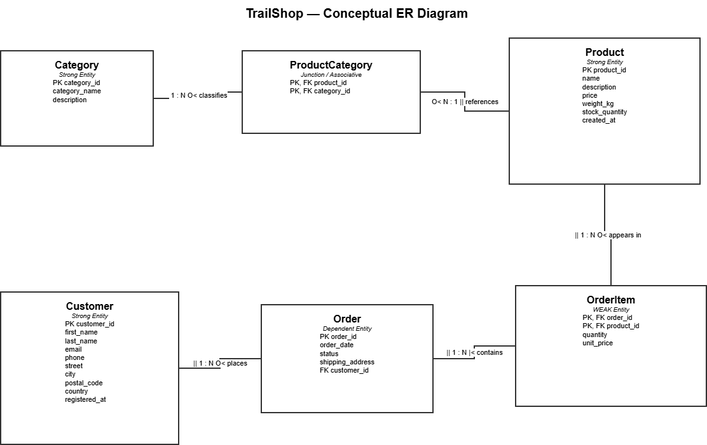
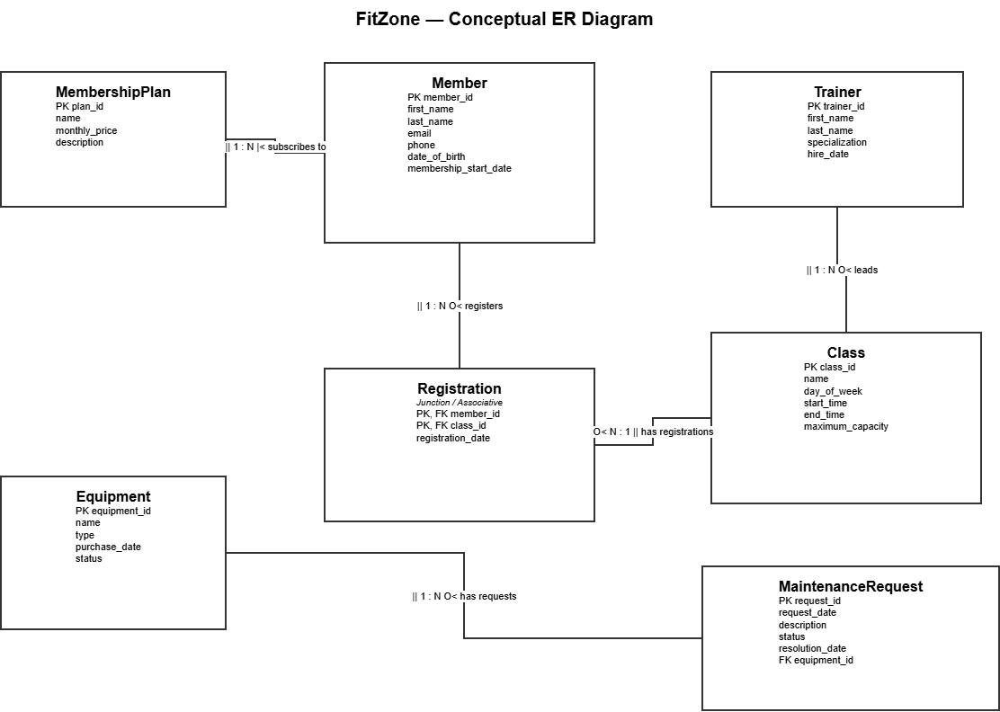

# Week 38 — Conceptual Data Modelling

## Exercise 1 — TrailShop Project Task

### ER Diagram

The complete TrailShop ER diagram is shown below:

### Design Decision

In Week 37, each product had one `category_id`, so one product could belong to only one category. This is not enough because one product can belong to several categories, such as Clothing and Accessories. Therefore, the Category–Product relationship is changed from 1:N to M:N and is resolved using the `ProductCategory` junction entity. Products no longer store `category_id`; `ProductCategory` stores the `product_id` and `category_id` pair.

`OrderItem` is a weak entity because it depends on `Order` for its identification. It also stores `quantity` and `unit_price`, because these values belong to the order item and the price should be preserved as it was when the order was placed.

---

# Exercise 2 — Theory Review Questions

## 1. Why should you create a conceptual data model before writing SQL?

A conceptual data model helps us understand what data exists and how the entities are related before creating database tables. It prevents duplicate data, missing relationships, and expensive redesign later. It also gives a clear plan before writing SQL.

## 2. What is the difference between the conceptual level and the logical level?

The conceptual level describes the business data using entities, attributes, relationships, and constraints without focusing on a specific database system. The logical level transforms this model into a specific data model, such as relational tables, keys, and relationships.

## 3. Explain logical data independence with an example.

Logical data independence means that the logical database structure can be changed without changing the external user views or applications. For example, we can split one logical table into two related tables while keeping the same user view through a database view.

## 4. Explain physical data independence with an example.

Physical data independence means that storage details can be changed without changing the logical database structure. For example, indexes or storage methods can be changed to improve performance while the tables and relationships remain the same.

## 5. What is the difference between a strong entity and a weak entity?

A strong entity can be uniquely identified using its own attributes. A weak entity depends on another entity for its identification. For example, `Employee` can be a strong entity, while `Dependent` can be a weak entity because it depends on an employee.

## 6. What is a composite attribute? How does it differ from a multivalued attribute?

A composite attribute can be divided into smaller meaningful parts. For example, `Address` can contain street, city, and postal code. A multivalued attribute can contain several values for one entity, such as several phone numbers for one customer.

## 7. What is a derived attribute?

A derived attribute is calculated from other stored attributes. For example, age can be calculated from date of birth. It is usually not stored because the value can be calculated when needed and storing it could create inconsistent data.

## 8. Explain the difference between a binary relationship and a unary relationship.

A binary relationship connects two entity types. For example, Customer places Order is a binary relationship. A unary or recursive relationship connects an entity type to itself, such as an Employee supervising another Employee.

## 9. What is the difference between an identifying relationship and a non-identifying relationship?

In an identifying relationship, the parent's primary key becomes part of the child's primary key. This is normally used when the child depends on the parent for identification. In a non-identifying relationship, the foreign key does not form part of the child's primary key.

## 10. What does a circle followed by a crow's foot mean?

A circle followed by a crow's foot means zero or many. The circle represents optional participation, and the crow's foot represents many. Therefore, `O<` means zero or many.

## 11. Why can't an M:N relationship be directly implemented in a relational database?

A relational table cannot store several related foreign-key values in one normal atomic column. Therefore, an M:N relationship must be resolved using a junction or associative entity. The junction contains foreign keys to both entities and creates two 1:N relationships.

## 11b. Why is `products.category_id` insufficient?

A single `products.category_id` can store only one category for each product. However, one product can belong to several categories. Therefore, the Category–Product relationship is changed to M:N and `ProductCategory` is used as the junction entity.

## 12. Employee and Department min-max notation

For Employee, the relationship is `(1,1)` because every employee must belong to exactly one department. For Department, the relationship is `(1,N)` because every department must have at least one employee and can have many employees.

---

# Exercise 3 — ER Diagram Reading Exercise

## Diagram A — Library System

### a) Can an author exist without having written any books?

Yes. The Author side is optional because the relationship uses `||` at the Author side and `O<` at the Book side. This means a category-like interpretation is that an author can have zero or many books.

### b) Can a book exist without being loaned?

Yes. The Book–Loan relationship allows zero or many loans for a book. Therefore, a book can exist even if it has never been loaned.

### c) What type of entity is Loan?

`Loan` is an associative entity between Book and Member. It represents the relationship between a member and a book and can store relationship-specific attributes such as loan date and return date.

### d) What is the cardinality of Author–Book?

The diagram shows a 1:N relationship: one author can have zero or many books, while each book has exactly one author. This may not be realistic because a book can have multiple authors. A more accurate model could use an M:N relationship resolved by a `BookAuthor` junction entity.

### e) What attributes would you add to Loan?

Useful attributes would include `loan_id`, `loan_date`, `due_date`, `return_date`, and possibly `status`. These attributes describe the loan itself.

---

## Diagram B — School System

### a) Can a student exist without being enrolled in any course?

Yes. The Student–Enrollment relationship allows zero enrollments. Therefore, a student can exist in the database without currently being enrolled in a course.

### b) Can a course exist without having any enrolled students?

Yes. A course can have zero or many enrollments. Therefore, a course can exist even when no students are currently enrolled.

### c) What is the cardinality between Student and Course?

Student and Course have an M:N relationship through Enrollment. One student can enroll in many courses, and one course can have many students.

### d) Can a teacher exist without teaching any courses?

Yes. The Teacher–Course relationship allows a teacher to have zero or many courses. Therefore, a teacher can exist without currently teaching a course.

### e) Is Teacher–Course 1:1 or 1:N?

The Teacher–Course relationship is 1:N. One teacher can lead many courses, while each course is taught by exactly one teacher. This means the model does not support team teaching where several teachers teach the same course.

---

# Exercise 4 — FitZone ER Diagram Creation

## 1. Entities and Attributes

### Member
- `member_id` (PK)
- `first_name`
- `last_name`
- `email`
- `phone`
- `date_of_birth`
- `membership_start_date`

### MembershipPlan
- `plan_id` (PK)
- `name`
- `monthly_price`
- `description`

### Trainer
- `trainer_id` (PK)
- `first_name`
- `last_name`
- `specialization`
- `hire_date`

### Class
- `class_id` (PK)
- `name`
- `day_of_week`
- `start_time`
- `end_time`
- `maximum_capacity`

### Registration
- `member_id` (PK, FK)
- `class_id` (PK, FK)
- `registration_date`

### Equipment
- `equipment_id` (PK)
- `name`
- `type`
- `purchase_date`
- `status`

### MaintenanceRequest
- `request_id` (PK)
- `request_date`
- `description`
- `status`
- `resolution_date`
- `equipment_id` (FK)

## 2. Relationships, Cardinality and Participation

### MembershipPlan — Member
- One MembershipPlan can have many Members.
- Each Member subscribes to exactly one MembershipPlan.
- Cardinality: 1:N.

### Trainer — Class
- One Trainer can lead many Classes.
- Each Class is led by exactly one Trainer.
- Cardinality: 1:N.

### Member — Registration
- One Member can have zero or many Registrations.
- Each Registration belongs to exactly one Member.
- Cardinality: 1:N.

### Class — Registration
- One Class can have zero or many Registrations.
- Each Registration belongs to exactly one Class.
- Cardinality: 1:N.

### Equipment — MaintenanceRequest
- One Equipment item can have zero or many MaintenanceRequests.
- Each MaintenanceRequest belongs to exactly one Equipment item.
- Cardinality: 1:N.

## 3. ER Diagram

## 4. Weak and Junction Entities

`Registration` is a junction or associative entity because it resolves the M:N relationship between Member and Class. It also has the relationship attribute `registration_date`.

`MaintenanceRequest` can be considered dependent on Equipment because each request is for exactly one piece of equipment. The main junction entity in this model is Registration.

## 5. M:N Relationships

Yes. Member and Class have an M:N relationship. A member can register for many classes, and a class can have many registered members. The `Registration` junction entity resolves this M:N relationship and stores `registration_date`.

---

# Exercise 5 — Find and Correct the Errors

## Error 1 — Multivalued `genres` attribute

### a) Error

The `genres` attribute in Books stores several values as a comma-separated string, for example:

`Fiction, Mystery, Thriller`

### b) Why is this a problem?

A multivalued attribute should not store several values in one atomic field. This violates the idea of atomic values and can make searching, updating, and maintaining the data difficult.

### c) Correction

Create a separate `Genre` entity and a junction entity such as `BookGenre`.

For example:

- `Book(book_id, title, author_name, price)`
- `Genre(genre_id, name)`
- `BookGenre(book_id, genre_id)`

---

## Error 2 — M:N relationship is implemented directly

### a) Error

The Books–Customer relationship is M:N but is implemented directly without a junction entity.

### b) Why is this a problem?

An M:N relationship cannot be directly implemented as a simple relational foreign key relationship. It needs a junction entity to resolve the relationship into two 1:N relationships.

### c) Correction

Create a junction entity between Book and Customer, depending on the business meaning. For example, if customers purchase books, the purchase/order structure should be used to connect Customer and Book.

---

## Error 3 — Missing Books–Purchase relationship

### a) Error

There is no relationship between Books and Purchase.

### b) Why is this a problem?

A purchase must identify which book or books were purchased. Without a relationship, the database cannot connect a purchase to the actual books.

### c) Correction

Add a relationship between Purchase and Book. If one purchase can contain many books and a book can appear in many purchases, create a junction entity such as `PurchaseItem`.

For example:

- `Purchase(purchase_id, purchase_date, customer_id)`
- `PurchaseItem(purchase_id, book_id, quantity, unit_price)`

---

## Error 4 — Entity naming convention

### a) Error

The entity is named `Books`, which uses a plural noun.

### b) Why is this a problem?

The Week 38 naming convention recommends using singular nouns for entity names. Singular names make the model consistent and easier to read.

### c) Correction

Rename:

`Books` → `Book`

The attributes can then use descriptive lowercase names such as `book_id`, `title`, and `price`.

---

# Submission Summary

The Week 38 folder contains:

- Exercise 1 — TrailShop ER diagram and explanation
- Exercise 2 — Theory questions
- Exercise 3 — Library and School ER diagram questions
- Exercise 4 — FitZone entities, relationships, diagram, and explanations
- Exercise 5 — Four errors, explanations, and corrections

## Files

- `TrailShop-ER-Diagram-CORRECTED.drawio.png`
- `FitZone-ER-Diagram-CORRECTED.drawio.png`
- `week38.md`
